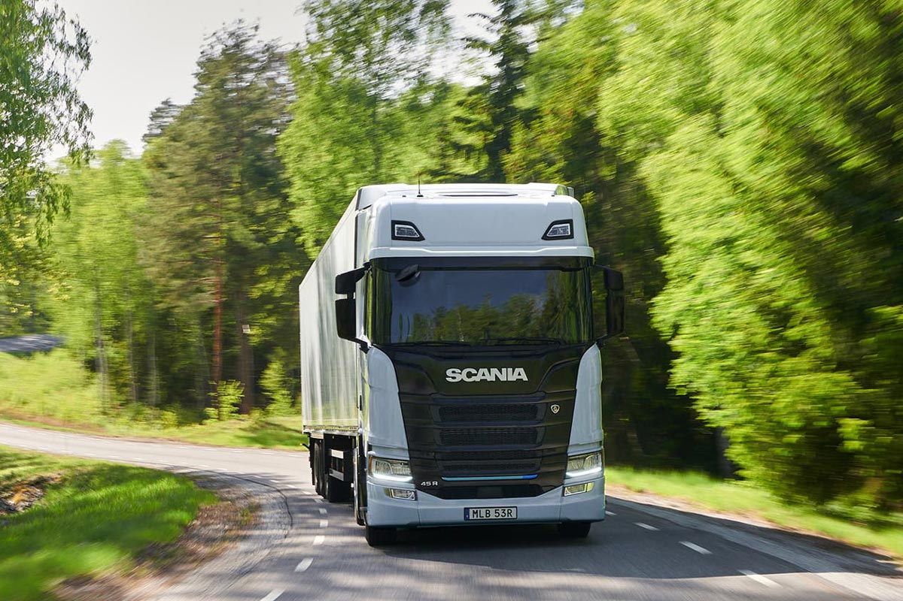
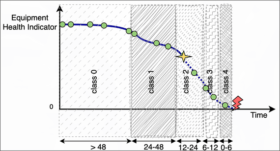

# Scania Component X Challenge

[Dataset](https://huggingface.co/datasets/<your-username>/<dataset-name>) | [Model](https://huggingface.co/<your-username>/<model-name>)

## Overview

This repo is my solution to the Scania Component X Challenge: a real-world predictive maintenance problem built from Scania truck fleet data. Given a vehicle's sensor readouts and specs, the goal is to estimate how close it is to a component failure so maintenance can be scheduled before the truck is stranded on the side of the road.



The classification error is asymmetric, with false negatives (missing a failure) weighted more heavily than false positives (unnecessary maintenance).

The model is an XGBoost classifier trained with balanced sample weights. At prediction time, probabilities are corrected for the true class prior, then each vehicle is assigned the class that minimizes expected cost under the challenge’s cost matrix (a Bayes-optimal decision rule) instead of the most probable class.

## Getting Started

Clone the repository:

```bash
git clone https://github.com/z-temepst/FleetGBM.git
cd FleetGBM
```

Download the dataset and model from Hugging Face:

```bash
pip install huggingface_hub

# Dataset
huggingface-cli download ZephyrNTempest/scaniacxc \
    --repo-type dataset \
    --local-dir data/

# Model
huggingface-cli download ZephyrNTempest/FleetGBM \
    --local-dir models/
```

## Results

| Split      | Score  | RMSE |
| ---------- | :----: | :--: |
| Validation | -41706 | 2.90 |
| Test       | -41189 | 2.67 |
